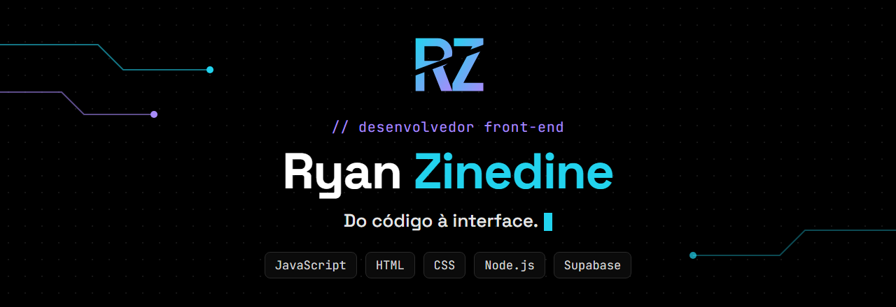

  

  

  
  
  

---

## // sobre

Trabalho na **[Mindloop](https://github.com/Mindloop2025)**, no **SmartRanch** — a
plataforma de monitoramento por câmeras para o agronegócio da empresa, com app
para Android e iOS.

O código do produto fica em repositórios privados da Mindloop. O que está público
neste perfil são os meus projetos de front-end e de IA aplicada, além de um
projeto em equipe do curso que fiz como Jovem Aprendiz.

## // smartranch

Produto da Mindloop, acompanhando **mais de 200 baias**. No dia a dia:

- Cadastro de novos clientes na plataforma: grupos, perfis e câmeras
- Configuração das câmeras e da transmissão (**fluxo RTMP**) para que as imagens cheguem ao app
- Duas páginas web feitas com apoio de IA (Claude): o fluxo de contratação e o cadastro de câmeras pelo próprio cliente
- Consultas e testes no banco de dados para apoiar a aplicação

## // projetos

| Projeto | O que é | Stack | No ar |
|---|---|---|---|
| **[Classifier](https://github.com/RyanZine/Projects/tree/main/classifier)** | Recomendação de trilhas de estudo: uma rede neural em TensorFlow.js classifica o perfil do aluno e uma LLM com escopo fechado (Gemini) monta a trilha só com o catálogo da plataforma, com retreino a partir do feedback dos alunos | Node.js · TensorFlow.js · Fastify · Gemini | [abrir](https://ryanzine.github.io/Projects/) |
| **[Portfolio](https://github.com/RyanZine/Portfolio)** | Meu portfólio — projetos, stack e trajetória, em layout dark responsivo | HTML · CSS · JS | [abrir](https://portfolio-ryanzine.vercel.app) |
| **[Coffe-Peace](https://github.com/RyanZine/Coffe-Peace)** | Landing page de cafeteria com carrinho simulado no front-end | HTML · CSS · JS | [abrir](https://coffe-peace.vercel.app) |
| **[Projeto-PP](https://github.com/RyanZine/Projeto-PP)** | Pequenos Programadores: site de cursos de programação para crianças, feito em equipe de sete pessoas no curso da Rede Despertar Sonhos | HTML · CSS · JS | — |

## // stack

  
  
  
  
  
   
  
  
  

## // atividade

  
  

## // estudando agora

Engenharia de IA Aplicada na UniPDS, onde nasceu o Classifier, e o CS50W, de
Harvard, onde começo a estudar back-end.

---

  <a href="mailto:zinedinepereira07@gmail.com">zinedinepereira07@gmail.com</a>

